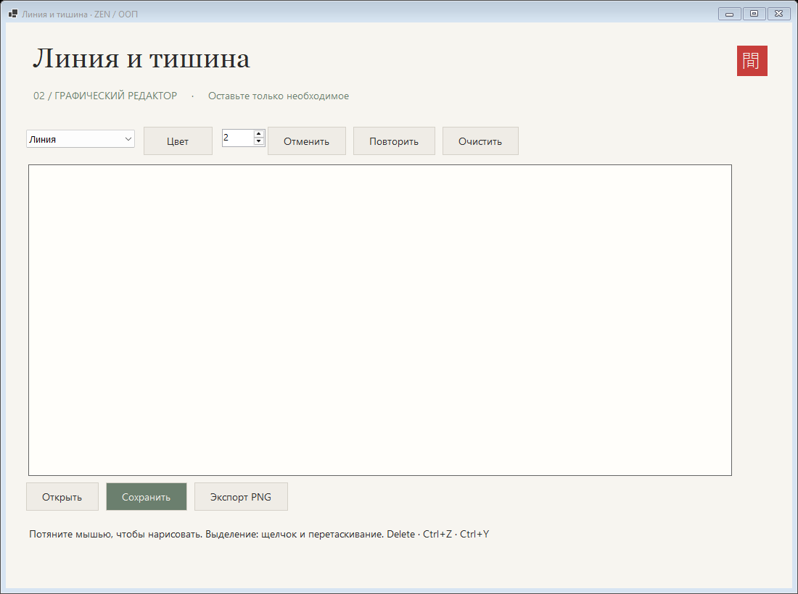

# Графический редактор

Автор: Ли Анастасия

## Запуск

Windows + .NET 8 SDK. Из корня репозитория:

```powershell
dotnet run --project lab2-paint/Paint.csproj
```



## Управление и устройство

Выберите инструмент, цвет и толщину; тяните мышью в любом направлении. «Выделить» позволяет выбрать верхнюю фигуру и переместить её. Delete удаляет выделенное, Ctrl+Z отменяет, Ctrl+Y повторяет. Открытие рисунка заменяет текущий документ и очищает историю команд. PNG экспортируется с фоном холста и без рамки выделения.

Абстрактный `Shape` содержит общую геометрию, `Draw`, `Contains`. Наследники `LineShape`, `RectShape`, `EllipseShape`, `PencilShape` реализуют рисование и проверку попадания. `Drawing` содержит фигуры и стеки команд `ICommand`; `EditCommand` хранит Execute/Undo. `ShapeFactory` восстанавливает конкретный класс по полю `Type` в JSON. Рисование одним циклом вызывает виртуальный `Draw`, без проверки типа. Поля JSON: Type, Color (ARGB), Width, Points.

Холст, инструменты, цвет, толщина.
Четыре инструмента и предпросмотр.
Абстракция и полиморфное рисование.
Отмена и очистка в модели.
JSON сохраняет типы, цвет, толщину и точки.
README и скриншот.
Выделение, перемещение, Delete.
Команды Undo/Redo для добавления, удаления, очистки и перемещения; PNG.
